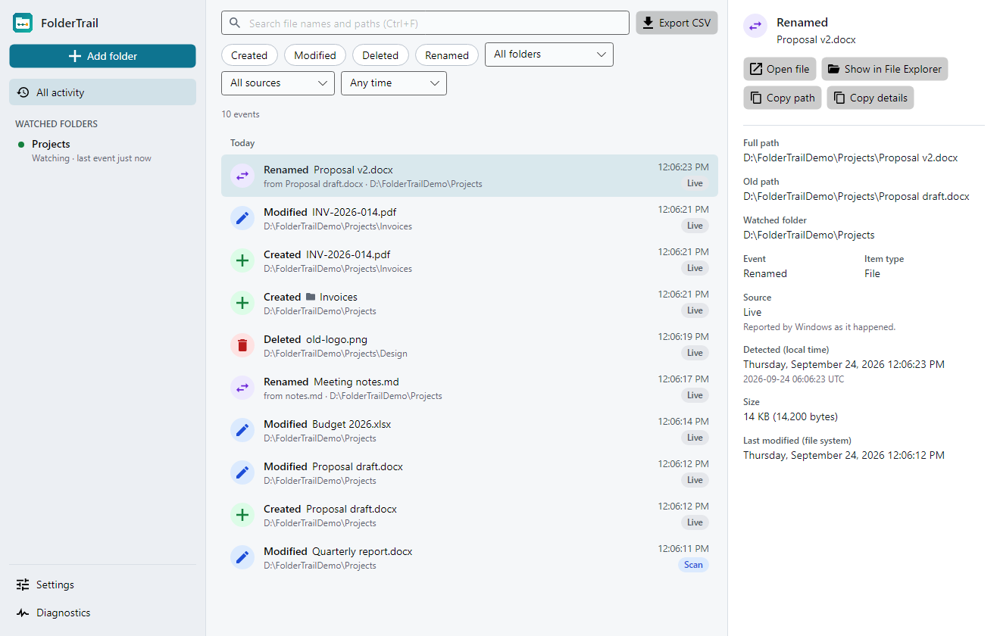
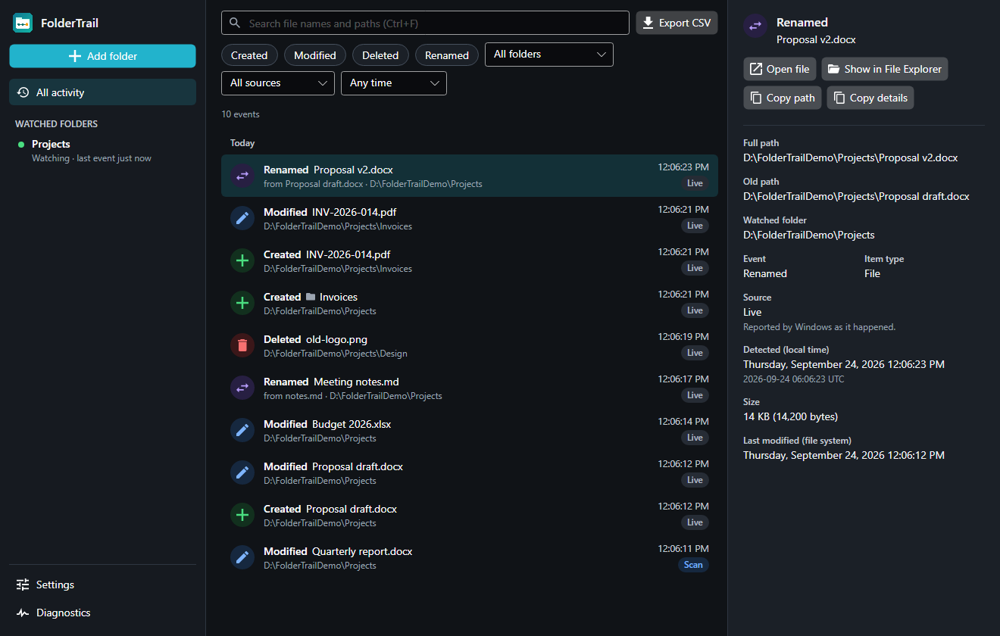

# FolderTrail

A Windows desktop app that keeps a **change journal** for folders you choose: what was created, modified,
deleted or renamed, and when. Search and filter the history, inspect each change, export to CSV.

> **A journal, not a backup.** FolderTrail stores names, paths, sizes and times — never file contents. It
> cannot restore a file.



<details><summary>Dark mode</summary>



</details>

## Features

- Watch any folder, with or without subfolders — nothing is watched until you add one, no admin rights needed.
- Live recording of creates/modifies/deletes/renames, plus periodic scans that catch what live monitoring
  missed (closed, paused, sleep, watcher errors). Scan-found changes are labelled and dated honestly — renames
  are never guessed, only reported when Windows says so directly.
- Searchable timeline grouped by day, filterable by folder/type/source/date, with CSV export.
- Per-folder and global exclusions with sensible defaults (`.git`, `bin`, `obj`, `node_modules`, temp files).
- Notification-area icon, optional close-to-tray, optional Start with Windows, single running instance.
- Diagnostics that never overstate what was actually captured.
- Light/dark themes, full keyboard navigation.

## Download and run

**[Download the latest release](https://github.com/dipjyotisikder/folder-trail/releases/latest)** — unzip and
run `FolderTrail.exe`. Self-contained (no .NET install needed), Windows 10/11 x64.

Not code signed, so SmartScreen will warn on first run — choose *More info → Run anyway*. `SHA256SUMS.txt` in
the release lets you verify the download.

## Build from source

Requires the [.NET 10 SDK](https://dotnet.microsoft.com/download) (pinned in `global.json`) and PowerShell.

```powershell
dotnet build FolderTrail.slnx -c Release
dotnet test FolderTrail.slnx -c Release           # unit, integration and headless-UI tests
dotnet run --project src/FolderTrail.App
```

Package versions are pinned in `Directory.Packages.props`; there are no commercial dependencies.

## Architecture

Organized by **feature, not technical layer** — `FolderTrail.Core/Features/<name>/` holds each feature's logic
and persistence together (WatchedFolders, Monitoring, Reconciliation, Timeline, Settings, Retention,
Diagnostics), instead of scattering it across `Models/`/`Services/`/`Repositories/`. `Core` has no Avalonia
reference, so it's fully testable without a UI. `FolderTrail.App` mirrors the same feature folders with one
Avalonia View + ViewModel per slice — MVVM is used only for that binding, not as an app-wide layer; a
ViewModel calls its feature's service directly, no mediator.

Monitoring runs a `FileSystemWatcher` per folder feeding a bounded channel, coalesced and written through a
single serialized SQLite writer (WAL mode) so the UI thread never blocks. A `MonitoringCoordinator` owns scan
scheduling and gap tracking through one control loop, so watcher errors, pauses and scans can't race. Scans
diff a stored inventory against disk; the first scan is a silent baseline, later ones record net differences
only — unreadable items are skipped, not treated as deletions, and identical rescans add nothing.

Tests run against real SQLite and a real temp folder, not mocks; headless UI tests render the actual window.

## Where data is stored

| What | Where |
|---|---|
| Database | `%LOCALAPPDATA%\FolderTrail\foldertrail.db` |
| Diagnostic log (paths redacted) | `%LOCALAPPDATA%\FolderTrail\diagnostics\` |
| Start with Windows (if enabled) | `HKCU\Software\Microsoft\Windows\CurrentVersion\Run` |

Nothing is written next to the executable or inside watched folders. **Settings → Delete all data** clears all
of the above. Set `FOLDERTRAIL_DATA_DIR` to use a different folder, e.g. for testing.

## Privacy

No network access, accounts, analytics, ads or auto-update checks — nothing leaves your computer. Diagnostic
logs have paths redacted by default; an export includes them only if you explicitly ask. History is kept 90
days by default (configurable 30/90/180/365/unlimited); the inventory of watched folders is kept while watched.

## Known limitations

- Windows change notifications can be lost; FolderTrail detects that and rescans, but a healthy watcher never
  *proves* every change was captured.
- A scan only finds net differences, dated when it ran — it can't reconstruct intermediate steps, and it
  reports a rename as a deletion + creation (only live notifications report true renames).
- Junctions/symlinks inside a watched folder are recorded but not followed.
- Alerts for monitoring problems show inside the app window, not as Windows toast notifications.

## Releasing

```powershell
./scripts/publish.ps1
```

Runs the tests, publishes self-contained `win-x64` folder and single-file builds, and zips them with
checksums into `artifacts/release/`. Builds are **not code
signed** — sign `FolderTrail.exe` yourself if you distribute it. Before shipping, manually verify on a real
Windows machine: first launch, folder picker, live events, rename, pause/resume, a missing drive,
close-to-tray, quit, restart, and CSV export.

## License

[MIT](LICENSE). Icons adapted from [Material Design Icons](https://pictogrammers.com/library/mdi/) (Apache 2.0).
